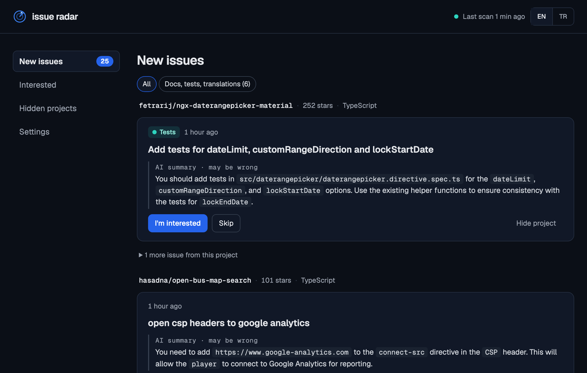

<p align="center">
  
</p>

<h1 align="center">Issue Radar</h1>

<p align="center"><strong>Find your next open-source contribution before someone else does.</strong></p>

<p align="center">
  <a href="https://github.com/fefezey/issue-radar/actions/workflows/tests.yml"></a>
  · <a href="README.tr.md">Türkçe</a>
</p>

Issue Radar helps developers find beginner-friendly issues on GitHub.

It scans GitHub for new issues, filters out tasks that are already claimed, and notifies you when it finds something worth looking at. You can choose which programming languages to follow, explore issues by project, and keep track of your contributions. It also offers optional AI summaries through Ollama, so you can understand an issue before getting started.

Everything runs locally on your Mac. Your data and preferences stay on your computer.

<p align="center"></p>

## What it does

Issue Radar finds beginner-friendly issues in the languages you follow and drops the ones someone has already claimed. On first run it picks those languages itself, by looking at your GitHub account. Next to every issue you see what the project is about and whether it actually merges pull requests from outside the team. You also see how long newcomers usually wait for the team's first answer, so you don't put work into a project that never answers.

If you have a local AI running, it summarizes issues and translates their titles into your language. When you decide to take an issue, it gives you a ready-made comment, the files worth looking at, and the project's setup and test commands. If you write your comment in another language, one click translates it into English. After that it follows your progress from your first comment to your merged pull request, and lets you know on your Mac when something important happens. It notices this even when you took the issue straight on GitHub. Every pull request of yours merged into someone else's project is listed under Contributions, grouped by project.

Later on we'd like to add more interface languages ([you can add yours](#add-a-language)), support notifications on Windows, and send them through Telegram or Discord.

## How it works

Every 10 minutes Issue Radar searches GitHub for new, open issues with a beginner label. From those it drops the ones that are assigned, have a linked pull request, were claimed in the comments, or belong to projects with fewer than 100 stars. Star counts are remembered for a day, so GitHub isn't asked again on every scan.

It also looks again at the issues it has already saved, and removes the ones that were closed or taken in the meantime. On each scan it gets to know a few projects as well: what the project does, how many pull requests from outside the team it merged recently, and how long those outsiders usually waited for a first comment, review or merge from the team. Bots don't count, and a pull request that never got an answer counts as the longest wait.

When Ollama is running, it writes a short summary for each new issue in the background, one at a time. Issues with a very short description are left alone, since the title already says enough. New issues are saved on your computer, you get a notification on your Mac, and the rest is up to you: open the page and pick the issue you want to work on.

## Getting started

Issue Radar needs [uv](https://docs.astral.sh/uv/), which also installs the right Python version for you:

```bash
brew install uv
```

Then download the project and start it:

```bash
git clone https://github.com/fefezey/issue-radar.git
cd issue-radar
uv run issue-radar
```

Now open **http://localhost:8000** in your browser. The first scan can take about a minute, and the page refreshes by itself.

### Start it when you log in

If you'd rather not start it by hand every time, let macOS run it in the background:

```bash
uv run issue-radar install
```

From then on it starts every time you log in to your Mac, and restarts itself if it ever crashes. You can read what it's doing in `~/.issue-radar/issue-radar.log`. Running `uv run issue-radar` while it's already running doesn't start a second copy, it just opens the page. To turn this off again, run:

```bash
uv run issue-radar uninstall
```

### AI summaries

This part is optional. Summaries and translations are written by the `gemma3:4b` model through [Ollama](https://ollama.com), which takes about 3 GB. It's free, and the text of the issues never leaves your computer:

```bash
brew install ollama
brew services start ollama
ollama pull gemma3:4b
```

Issue Radar notices Ollama by itself. The model runs on a Mac with 8 GB of memory, but if summaries come in slowly, closing heavy apps like the iOS Simulator helps. To try another model, set `OLLAMA_MODEL` when you start it, as in `OLLAMA_MODEL=qwen2.5:3b uv run issue-radar`. The summaries come from a small model and can be wrong now and then, so the real issue is always one click away.

### GitHub access

Without signing in, GitHub allows only 60 requests an hour, which isn't enough. So Issue Radar first looks for a `GITHUB_TOKEN` environment variable, and if there isn't one, uses your [GitHub CLI](https://cli.github.com/) login. The easiest way is to run `gh auth login` once. The token only needs to read public data.

### Notifications

Notifications show Issue Radar's name and radar icon. To make that work, it builds a tiny helper app in `~/.issue-radar/` the first time it notifies you. If you're curious what they look like, press **Send a test notification** on the Settings page. If nothing shows up, allow notifications for Issue Radar in the Notifications section of System Settings. On Linux, notifications go through `notify-send`, which most desktops already have.

## Configuration

On the Settings page you choose which languages you want to see issues in. You can tick as many as you like from Python, JavaScript, TypeScript, Go, Rust, Java, C, C#, C++, Ruby, PHP, Kotlin and Swift.

On first run Issue Radar picks them for you. It looks at your own projects on GitHub and the projects you've sent pull requests to, and ticks the languages you use most. Projects you've sent pull requests to count double, because fixing issues there is closer to what you'll be doing. You can do this again later with **Pick my languages from GitHub**. If you've never signed in to GitHub, it starts with Python and JavaScript. Changes apply right away, and a new scan starts immediately.

Only projects with at least 100 stars are shown. Smaller projects often go quiet, and a first pull request there may never be looked at.

How often it scans (10 minutes), how long it waits after a failed scan (5 minutes) and how often it notifies you (at most once an hour) live at the top of `src/issue_radar/scanner.py` for now, if you want to change them. Your issues and preferences are stored in `~/.issue-radar/issues.db`. Delete that file if you want to start from scratch.

## Project structure

All of the code lives in `src/issue_radar/`. The program starts in `__init__.py`, which runs the scanner and the web page, while `__main__.py` and `service.py` take care of starting it when you log in. Everything that talks to GitHub is in `github.py`: searching, star counts, claimed issues and your pull requests. `scanner.py` scans on a schedule and decides when a notification goes out, and `notify.py` shows the notifications themselves.

AI summaries and translations are in `ai.py`. `kinds.py` recognizes easy issues such as docs, tests and translations. `claiming.py` prepares the comment draft and reads projects' contributing guides, and `guide.py` puts together the issue guide, with setup and test commands and the files worth looking at.

Data is kept in a local SQLite database through `db.py`. The web page's addresses are in `web.py`, and the page itself is `templates/index.html`. Settings are in `settings.py` and the searchable languages in `languages.py`. `i18n.py` handles the interface translations, with one JSON file per interface language in `locales/`.

## Contributing

Contributions are welcome; after all, this is a tool for people making their first ones. The easiest place to start is adding a language to the interface. You don't need to know how to code for that, and it's explained below.

If you'd like to touch some code, have a look at `CLAIM_PHRASES` in `github.py`. It holds the sentences people write when they take an issue, and you can add new ones you come across. `kinds.py` tries to recognize easy issues from their titles and labels, so if you see one it missed or got wrong, you can fix the rules. `notify.py` works on macOS and Linux for now, and adding Windows support would be a great contribution too. If you're thinking of a bigger change, please open an issue first so we can talk about it.

### Run the tests

```bash
uv run pytest
```

The tests don't need internet access, a GitHub token or Ollama. GitHub's and the model's answers are made up inside the tests, and each test uses its own empty database. They also run automatically on GitHub for every push and pull request.

### Add a language

To add an interface language, copy `src/issue_radar/locales/en.json` to a new file named after your language code, like `de.json` for German. Then translate the texts on the right. Leave the keys on the left and the placeholders in `{curly braces}` as they are, since the program uses them.

Some words change with a number, like "1 star" but "3 stars". For those there are two keys, ending in `.one` and `.other`. If words in your language don't change, `.other` alone is enough. When you're done, start the program with `uv run issue-radar` and pick your language in the top right corner. Anything you haven't translated shows up in English.

## License

[MIT](LICENSE)

---

<p align="center"><em>Contribute more. Search less.</em></p>
