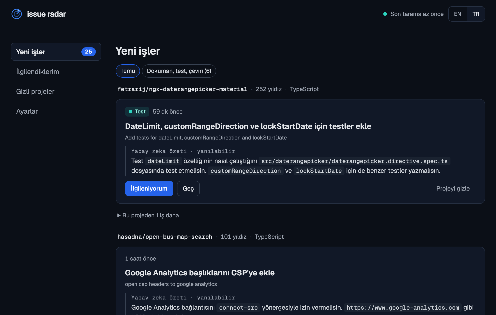

<p align="center">
  
</p>

<h1 align="center">Issue Radar</h1>

<p align="center"><strong>Bir sonraki açık kaynak katkını, başkası kapmadan bul.</strong></p>

<p align="center">
  <a href="https://github.com/fefezey/issue-radar/actions/workflows/tests.yml"></a>
  · <a href="README.md">English</a>
</p>

Issue Radar, GitHub'da yeni başlayanlara uygun işleri bulmana yardım eder.

GitHub'ı yeni işler için tarar, başkasının çoktan aldığı işleri ayıklar ve bakmaya değer bir şey bulduğunda sana haber verir. Hangi programlama dillerini takip edeceğini seçebilir, işleri projelere göre inceleyebilir ve katkılarını takip edebilirsin. İstersen Ollama üzerinden yapay zeka özetleri de alırsın; böylece bir işe başlamadan önce ne istendiğini anlarsın.

Her şey kendi Mac'inde çalışır. Verilerin ve tercihlerin bilgisayarında kalır.

<p align="center"></p>

## Neler yapıyor

Issue Radar, takip ettiğin dillerde yeni başlayanlara uygun işleri bulur ve başkasının çoktan aldığı işleri ayıklar. Dilleri ilk açılışta senin GitHub hesabına bakarak kendisi seçer. Her işin yanında projenin ne olduğunu ve ekip dışından gelen PR'ları birleştirip birleştirmediğini görürsün, böylece cevap vermeyen bir projeye boşuna emek harcamazsın.

Bilgisayarında çalışan bir yapay zeka varsa işleri özetler ve başlıklarını senin diline çevirir. Bir işi almaya karar verdiğinde sana hazır bir yorum taslağı, bakman gereken dosyaları ve projenin kurulum ve test komutlarını gösterir. Yorumunu Türkçe yazarsan tek tuşla İngilizceye çevirebilirsin. Sonra ilk yorumundan PR'ının birleşmesine kadar ilerlemeni takip eder ve önemli bir şey olduğunda Mac'inde haber verir.

İleride bakımcıların yeni gelenlere ne kadar hızlı cevap verdiğini göstermeyi, daha fazla arayüz dili eklemeyi ([kendi dilini ekleyebilirsin](#dil-ekle)), Linux ve Windows'ta bildirim göstermeyi ve Telegram ya da Discord'dan haber vermeyi planlıyoruz.

## Nasıl çalışıyor

Issue Radar 10 dakikada bir GitHub'da başlangıç etiketi taşıyan yeni, açık işleri arar. Bulduklarından atanmış olanları, bağlı bir PR'ı olanları, yorumlarda birinin "ben alıyorum" dediklerini ve 100 yıldızdan az projelere ait olanları eler. Projelerin yıldız sayılarını bir gün boyunca hatırladığı için GitHub'a her taramada yeniden sormaz.

Daha önce kaydettiği işlere de düzenli olarak tekrar bakar ve o arada kapanan ya da başkasının aldığı işleri listeden çıkarır. Her taramada birkaç projeyi de tanımaya çalışır; projenin ne işe yaradığına ve son zamanlarda ekip dışından kaç PR birleştirdiğine bakar (botları saymaz).

Ollama çalışıyorsa her yeni işe arka planda, sırayla kısa bir özet yazar. Açıklaması çok kısa olan işleri özetlemez, çünkü orada başlık zaten yeterince şey söylüyor. Yeni işleri bilgisayarına kaydeder, Mac'inde bildirim gösterir ve gerisini sana bırakır. Web sayfasını açıp üzerinde çalışmak istediğin işi sen seçersin.

## Kurulum

Issue Radar'ı çalıştırmak için [uv](https://docs.astral.sh/uv/) gerekiyor. Doğru Python sürümünü de o kuruyor:

```bash
brew install uv
```

Sonra projeyi indirip başlat:

```bash
git clone https://github.com/fefezey/issue-radar.git
cd issue-radar
uv run issue-radar
```

Ardından tarayıcıda **http://localhost:8000** adresini aç. İlk tarama bir dakika kadar sürebilir, sayfa kendiliğinden yenilenir.

### Mac açılınca kendiliğinden başlasın

Programı her seferinde elle başlatmak istemiyorsan macOS'un onu arka planda çalıştırmasını sağlayabilirsin:

```bash
uv run issue-radar install
```

Bundan sonra Mac'ine her girişte kendiliğinden başlar, bir gün çökerse de kendini yeniden başlatır. Neler yaptığını `~/.issue-radar/issue-radar.log` dosyasından okuyabilirsin. Program zaten çalışırken `uv run issue-radar` yazarsan ikinci bir kopya açılmaz, yalnızca sayfa açılır. Bu özelliği kapatmak istersen şunu çalıştır:

```bash
uv run issue-radar uninstall
```

### Yapay zeka özetleri

Bu kısım isteğe bağlı. Özetleri ve çevirileri [Ollama](https://ollama.com) üzerinden yaklaşık 3 GB'lık `gemma3:4b` modeli yazıyor. Ücretsiz, ve işlerin metni bilgisayarından hiç çıkmıyor:

```bash
brew install ollama
brew services start ollama
ollama pull gemma3:4b
```

Issue Radar Ollama'yı kendisi fark eder. Model 8 GB belleği olan bir Mac'te de çalışıyor, ama özetler yavaş gelirse iOS Simülatörü gibi ağır uygulamaları kapatmak işe yarar. Başka bir model denemek istersen başlatırken `OLLAMA_MODEL` ayarını değiştirebilirsin, örneğin `OLLAMA_MODEL=qwen2.5:3b uv run issue-radar` gibi. Özetleri küçük bir model yazdığı için arada yanılabiliyor; işin aslı her zaman bir tık uzağında.

### GitHub erişimi

GitHub, giriş yapmadan saatte yalnızca 60 isteğe izin veriyor ve bu yetmiyor. Bu yüzden Issue Radar önce `GITHUB_TOKEN` ortam değişkenine bakar, o yoksa [GitHub CLI](https://cli.github.com/) girişini kullanır. En kolayı bir kere `gh auth login` çalıştırmak. Token'ın yalnızca herkese açık verileri okuyabilmesi yeterli.

### Bildirimler

Bildirimler Issue Radar adı ve radar logosuyla gelir. Program bunun için ilk bildirimde `~/.issue-radar/` klasöründe küçük bir yardımcı uygulama oluşturur. Nasıl göründüğünü merak ediyorsan Ayarlar sayfasındaki **Deneme bildirimi gönder** düğmesine bas. Hiçbir şey görmüyorsan Sistem Ayarları'ndaki Bildirimler bölümünden Issue Radar'a izin vermen gerekiyor.

## Ayarlar

Ayarlar sayfasında hangi dillerdeki işleri görmek istediğini seçersin. Python, JavaScript, TypeScript, Go, Rust, Java, C, C#, C++, Ruby, PHP, Kotlin ve Swift arasından istediğin kadarını işaretleyebilirsin.

İlk açılışta dilleri senin yerine Issue Radar seçer. GitHub'daki kendi projelerine ve PR gönderdiğin projelere bakar, en çok kullandığın dilleri işaretler. PR gönderdiğin projeler iki kat sayılır, çünkü issue çözmek oraya daha yakın bir iş. Bunu sonradan **Dillerimi GitHub'dan seç** düğmesiyle tekrarlayabilirsin. GitHub'a hiç bağlanmadıysan Python ve JavaScript ile başlar. Yaptığın değişiklikler hemen uygulanır ve yeni bir tarama başlar.

Yalnızca en az 100 yıldızı olan projeler gösterilir. Daha küçük projeler çoğu zaman sessizleşiyor ve ilk PR'ına kimse bakmayabiliyor.

Tarama sıklığı (10 dakika), başarısız bir taramadan sonra tekrar deneme süresi (5 dakika) ve bildirim sıklığı (saatte en fazla bir) şimdilik `src/issue_radar/scanner.py` dosyasının en üstünde duruyor; değiştirmek istersen oradan değiştirebilirsin. İşlerin ve tercihlerin `~/.issue-radar/issues.db` dosyasında saklanıyor. Sıfırdan başlamak istersen bu dosyayı silmen yeterli.

## Proje yapısı

Kodun tamamı `src/issue_radar/` klasöründe. Program `__init__.py` ile başlar; bu dosya tarayıcıyı ve web sayfasını çalıştırır. `__main__.py` ve `service.py` ise programın Mac açılınca kendiliğinden başlamasını sağlar. GitHub'la konuşan her şey `github.py` içinde: arama, yıldız sayıları, alınmış işler ve senin PR'ların. `scanner.py` düzenli aralıklarla tarama yapar ve ne zaman bildirim gideceğine karar verir. Bildirimlerin kendisini `notify.py` gösterir.

Yapay zeka özetleri ve çeviriler `ai.py` dosyasında. `kinds.py` doküman, test ve çeviri gibi kolay işleri tanır. `claiming.py` yorum taslağını hazırlar ve projelerin katkı rehberlerini okur. `guide.py` ise iş rehberini, yani kurulum ve test komutlarını ve bakılacak dosyaları çıkarır.

Veriler `db.py` ile yerel bir SQLite veritabanında tutulur. Web sayfasının adresleri `web.py` içinde, sayfanın kendisi `templates/index.html` dosyasında. Ayarlar `settings.py`, aranabilecek diller `languages.py` içinde. Arayüz çevirilerini `i18n.py` yönetir; her arayüz dili için `locales/` klasöründe bir JSON dosyası var.

## Katkı

Katkılarını bekliyoruz; ne de olsa bu, ilk katkısını yapacaklar için yapılmış bir araç. Başlamak için en kolay yol arayüze yeni bir dil eklemek. Bunun için kod bilmen gerekmiyor, nasıl yapılacağı aşağıda anlatılıyor.

Biraz kodla uğraşmak istersen `github.py` içindeki `CLAIM_PHRASES` listesine bakabilirsin. Bu liste, insanların bir işi alırken yazdığı cümleleri tutuyor; karşına çıkan yeni kalıpları ekleyebilirsin. `kinds.py` da başlıklardan ve etiketlerden kolay işleri tanımaya çalışıyor. Kaçırdığı ya da yanlış tanıdığı bir iş görürsen kuralları düzeltebilirsin. `notify.py` şimdilik yalnızca macOS'ta çalışıyor, Linux ya da Windows desteği eklemek de güzel bir katkı olur. Büyük bir değişiklik düşünüyorsan önce bir issue açıp konuşalım.

### Testleri çalıştır

```bash
uv run pytest
```

Testler için internet, GitHub token'ı ya da Ollama gerekmiyor. GitHub'ın ve modelin cevapları testlerin içinde taklit ediliyor, her test de kendi boş veritabanını kullanıyor. Testler her push'ta ve her PR'da GitHub'da otomatik olarak da çalışıyor.

### Dil ekle

Yeni bir arayüz dili eklemek için `src/issue_radar/locales/en.json` dosyasını kopyala ve kopyaya kendi dil kodunu ver, Almanca için `de.json` gibi. Sonra sağ taraftaki metinleri çevir. Soldaki anahtarlara ve `{süslü parantez}` içindeki yer tutuculara dokunma, program onları kullanıyor.

Bazı kelimeler sayıya göre değişir. İngilizcede "1 star" ama "3 stars" denir. Bunun için `.one` ve `.other` ile biten iki anahtar var. Senin dilinde kelime sayıyla değişmiyorsa yalnızca `.other` yeterli. İşin bitince `uv run issue-radar` ile programı başlat ve sağ üst köşeden dilini seç. Çevirmediğin metinler İngilizce görünür.

## Lisans

[MIT](LICENSE)

---

<p align="center"><em>Daha çok katkı, daha az arama.</em></p>
